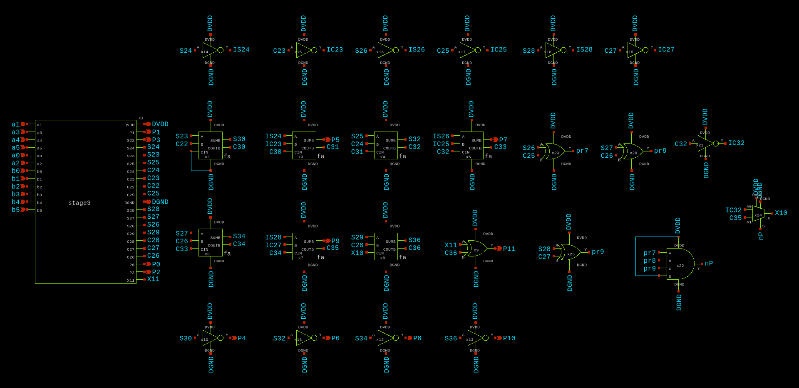
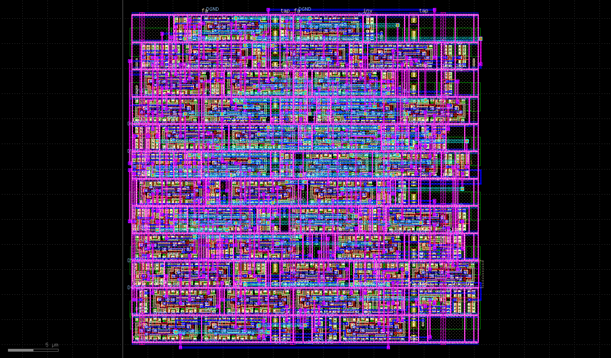

# 6×6 Wallace Tree Multiplier (SKY130)

A 6-bit × 6-bit unsigned multiplier built as a **Wallace tree** in the SkyWater
SKY130 process. It takes two inputs `A[5:0]` and `B[5:0]` (0 to 63) and produces a
12-bit product `P[11:0]`.

The 36 partial products (`a_i · b_j`, weight 2^(i+j)) are formed with NAND gates and
reduced in three stages of full adders. The final two rows are added by a
carry-bypass adder (the vector merge). The design was drawn in Xschem, laid out
for full-custom use, and verified with DRC, LVS, and pre/post-layout SPICE simulation.

## Results

| Check | Result |
|-------|--------|
| DRC (KLayout / Magic) | No errors found |
| LVS | Layout and reference netlists match |

Critical-path delay to `P11` (worst case: Vector 1, `b1` toggling, 35 × 57 → 35 × 59):

| | Delay |
|---|---|
| Pre-layout | **1.652 ns** |
| Post-layout (extracted parasitics) | **2.696 ns** (about 63% slower) |

Delay for all three test vectors (average of rise and fall, measured at 0.9 V):

| Vector | Pulsed input | Pre-layout (ns) | Post-layout (ns) |
|:-:|:-:|:-:|:-:|
| 1 | `b1` | 1.652 | 2.696 |
| 2 | `b0` | 1.466 | 2.634 |
| 3 | `a0` | 1.060 | 1.871 |

The critical path was found from three chosen input vectors, not an exhaustive
search over all input transitions. Each vector makes the product cross 2048 so
that `P11` flips and the carry propagates through the whole tree. Only one input
is pulsed at a time; all others are held at DC (1.8 V for logic 1, 0 V for logic 0).

Input vectors used:

| Vector | Pulsed input | A | B | Product | P11 |
|:-:|:-:|:-:|:-:|:-:|:-:|
| 1 | `b1` | 35 (100011) | 57 → 59 (111001 → 111011) | 1995 → 2065 | 0 → 1 |
| 2 | `b0` | 33 (100001) | 62 → 63 (111110 → 111111) | 2046 → 2079 | 0 → 1 |
| 3 | `a0` | 32 → 33 (100000 → 100001) | 63 (111111) | 2016 → 2079 | 0 → 1 |

## Images

| Top-level schematic | Layout |
|---|---|
|  |  |

Stage schematics: [stage 1](images/stage1.png) · [stage 2](images/stage2.png) · [stage 3](images/stage3.png)

Verification and simulation screenshots are in [`images/results/`](images/results/).

## Repository layout

```
├── xschem/          Schematics (.sch), symbols (.sym) and SPICE netlists
│                    - wallace, stage1/2/3 and the cells: fa, inv, nand2, nand4, xor2, mux2
│                    - pre_layout / post_layout testbenches
│                    - wallace_extracted.spice (post-layout extracted netlist)
├── layout/          wallace.gds, nand2.gds, layout picture
├── verification/    KLayout DRC report and LVS comparison output
└── images/          Schematic, testbench and result screenshots
```

Keep all files in `xschem/` together in one folder. Xschem finds the symbols
by name, and `post_layout.spice` includes `wallace_extracted.spice` by relative path.

## Reproducing the simulations

Tools used: [Xschem](https://xschem.sourceforge.io/), [ngspice](https://ngspice.sourceforge.io/),
[Magic](http://opencircuitdesign.com/magic/), [KLayout](https://www.klayout.de/), and the
[SKY130 PDK](https://github.com/google/skywater-pdk) (`tt` corner).

1. Install the PDK and open `xschem/pre_layout.sch` or `xschem/post_layout.sch`.
2. **Edit the PDK path.** The testbenches contain
   `.lib /cad/share/pdk/sky130B/libs.tech/combined/sky130.lib.spice tt`, which is
   the path on the original machine. Change it to your own PDK install location.
3. Run the testbench with ngspice. It runs a 30 ns transient, pulses one input
   (`PULSE(0 1.8 5n 100p 100p 20n 30n)`), holds the others at DC, and prints the
   rise and fall delays and their average for each output `P0` to `P11`.
4. To change the input vector, edit the DC values on the input sources and
   choose which input is pulsed.

Command-line example:

```
cd xschem
ngspice pre_layout.spice
ngspice post_layout.spice
```

The `.sch` files contain absolute paths from the original machine
(`/home/student/ee5311/Wallace/...`). Xschem normally resolves them
from the current folder, so this should not matter.

## Notes

- `post_layout.spice` uses `wallace_extracted.spice`, the netlist extracted from `layout/wallace.gds`.
- The LVS database, extracted/LVS netlists and similar large generated files are not
  included. They can be regenerated from the layout (see `.gitignore`).
